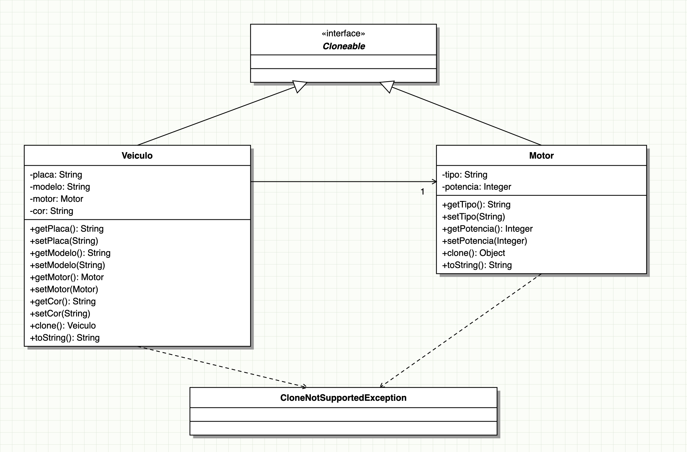

# Prototype: Veículo e Motor

Implementação do padrão de projeto **Prototype**, aplicada a veículos.

## Diagrama UML



Versão editável em Mermaid: [docs/diagrama-uml.md](docs/diagrama-uml.md).

## Como rodar os testes

```
mvn test
```
